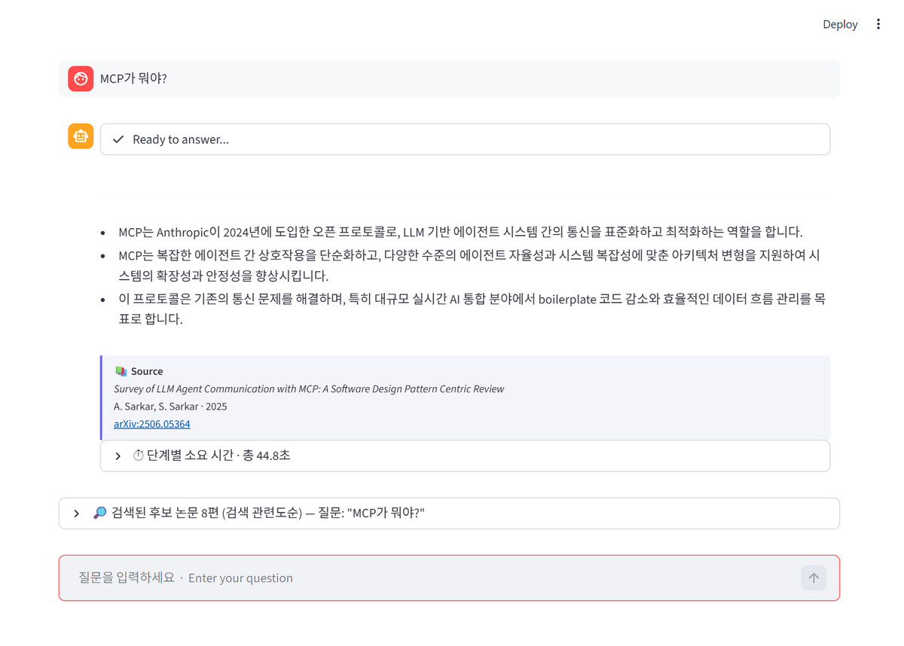
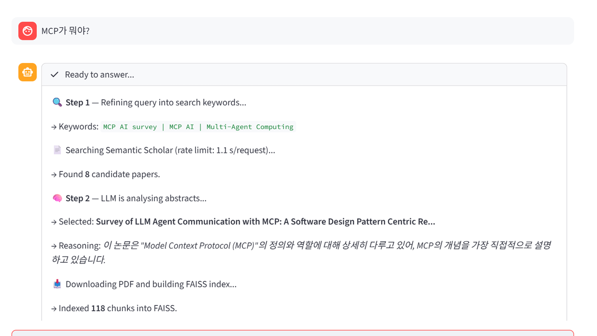
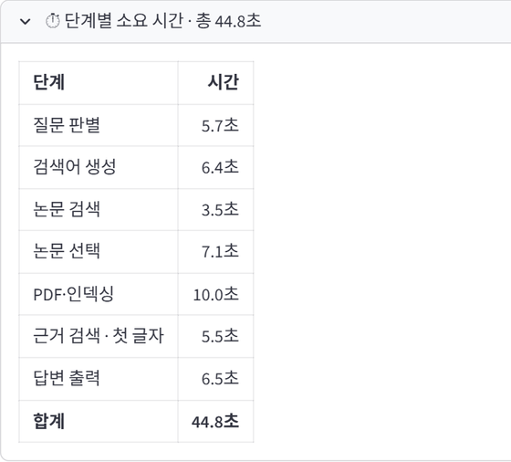

# 졸업작품 — ScholarMind: 로컬 RAG 논문 어시스턴트

한국어로 질문하면 논문을 찾아 원문 PDF를 읽고, 그 내용을 근거로 출처와 함께 답하는 시스템입니다.
전용 그래픽카드 없는 일반 노트북에서 동작하며, 언어 모델(EXAONE 3.5 2.4B)은 노트북 안에서 돌고 내장 그래픽이 있으면 가속합니다(없으면 CPU).
클라우드 LLM API를 쓰지 않아 질문 원문과 답변 생성은 노트북 안에서 처리되고, 외부로는 논문 검색용 영어 키워드와 논문 ID만 나갑니다.

## 시연 영상

https://github.com/user-attachments/assets/39935e8a-126a-4f46-ad60-8164a97344bf

**[발표 자료 (PDF, 19쪽)](Scholarmind/docs/presentation.pdf)**

## 주요 결과

| 항목 | 결과 |
|---|---|
| 첫 질문 응답 시간 | 47초 → 25초 (단계별 시간 측정으로 요청마다 2.15초 지연을 찾아 제거) |
| 내장 그래픽 가속 | 논문 선택 3.1배(29.6초 → 9.5초), 답변 생성 1.8배(16.5초 → 9.1초) |
| 품질 유지 확인 | CPU와 같은 논문을 고른 비율 14개 중 13개 |
| 자동 점검 | 시스템 44개 항목 통과, 일부러 넣은 고장 76개 모두 검출 |
| 검증 시간 | 수동 30분 → 리포트 확인 3분 |

  
  

두 버전이 있습니다.

## [ragxiv/](./ragxiv) — 1차 버전

arXiv에서 논문을 찾아 한 편을 골라 답합니다.
자율 2단계 에이전트 구조와 후속 질문 감지를 구현했습니다.

## [Scholarmind/](./Scholarmind) — 2차 버전

논문 출처를 Semantic Scholar로 바꾸고 다음을 추가했습니다.

- 신뢰도 필터 — DOI·게재처·피인용 수 기준으로 후보를 거름
- 하이브리드 검색 — BM25 어휘 검색과 벡터 검색을 RRF로 융합
- 다중 소스 PDF 확보 — arXiv, Unpaywall 등을 순차 시도
- 답변 스트리밍
- 후보 논문 목록 — 다른 논문으로 바꿔 다시 답하기
- 내장 GPU 가속 — 논문 선택 3.1배, 답변 1.8배 빨라짐
- 단계별 시간 측정 — 질문마다 단계별 소요 시간을 표로 보여주고 기록
- 자동 점검 — 시스템 44개 항목 검사, 주입한 고장 76개 검출

## 왜 두 가지 버전으로 만들었나

1차 버전을 실제로 써보니 세 가지가 걸렸습니다.
arXiv는 심사를 거치지 않은 논문이 대부분이라 신뢰도를 판단할 수 없었고, 의미 기반 검색만으로는 약어나 고유명사를 놓쳤으며, 답변이 완성될 때까지 화면이 멈춰 있었습니다.
2차 버전은 이 세 가지를 해결한 결과입니다.

| | |
|---|---|
| 기술 | Python, Streamlit, Ollama, EXAONE 3.5 2.4B, multilingual-e5, FAISS, BM25 |
| 개발 환경 | i7-1355U(Intel Iris Xe 내장 그래픽) + 16GB RAM |

만들면서 겪은 문제와 해결 과정, 실행 방법은 [Scholarmind/README.md](./Scholarmind/README.md)에 있습니다.
